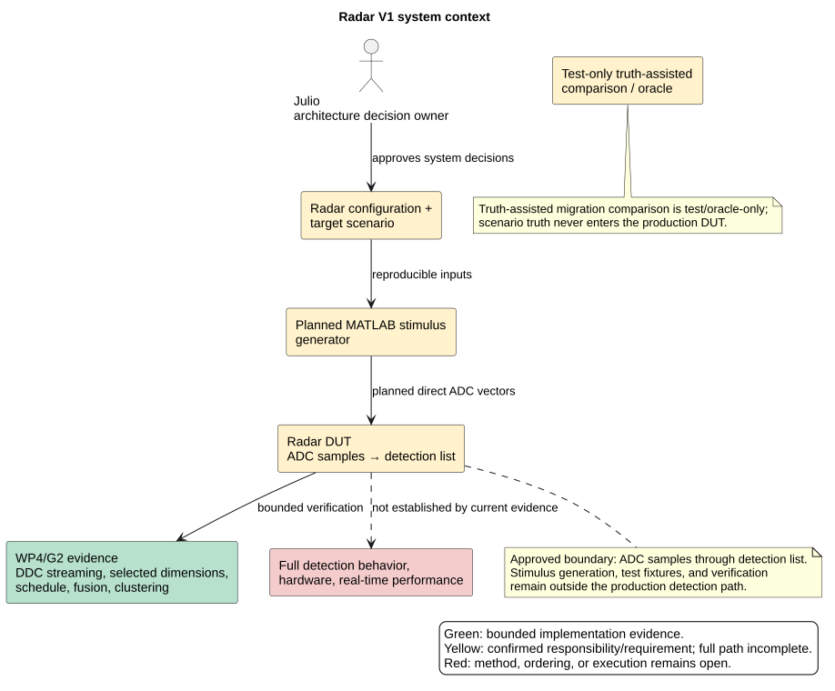
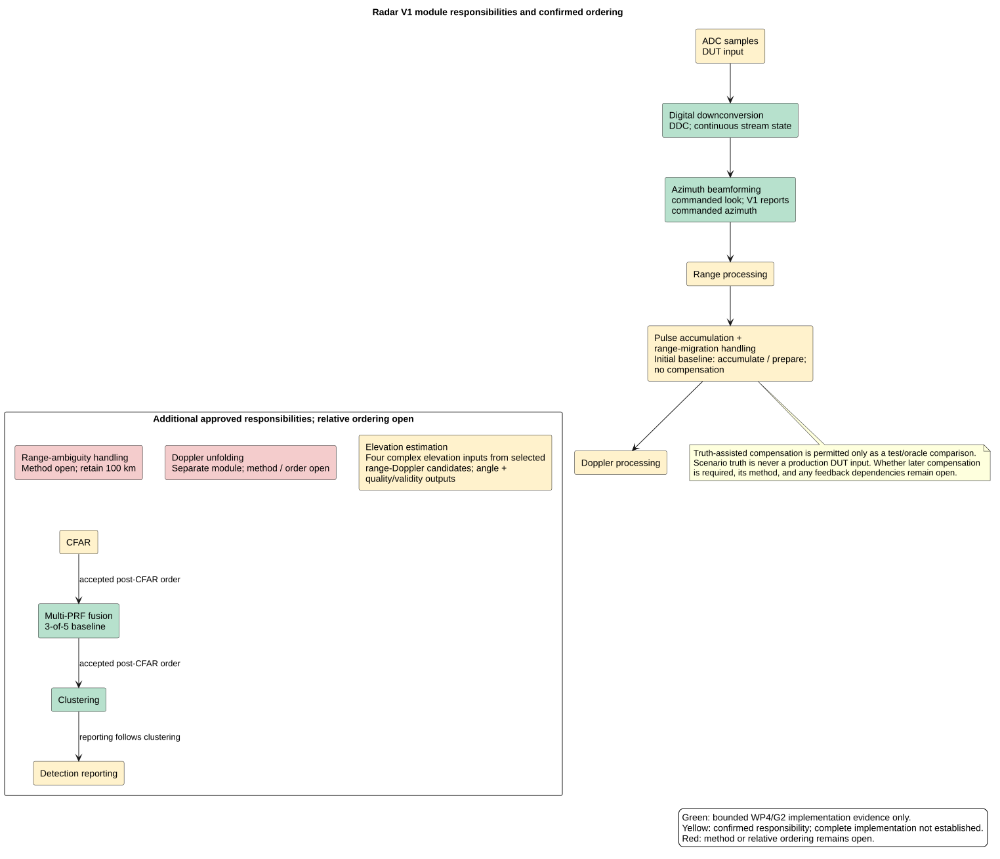

# Radar V1 architecture overview

**Review status:** Documents passed independent semantic review on
2026-09-26. Architecture responsibilities below reflect Julio’s confirmed
shared understanding as of that date. Internal interfaces, unresolved ordering,
and execution details remain open. Julio accepted the redrawn diagrams on
2026-10-26 at PR #17 head `460656c8c54118d5a2d52af20dc60e7eb45d42b3`.
This owner visual approval does not resolve open architecture choices or establish
complete code review, MATLAB verification, or receiver implementation.

## Purpose and audience

Views give Julio and project contributors readable map of radar
system boundary, approved module responsibilities, bounded implementation
evidence, and remaining decisions. Document confirmed choices without
selecting unresolved algorithms, interfaces, or execution topology.

## Status legend

- **Green — Bounded implementation evidence:** independently verified within
  WP4/G2 scope. Green does not mean full receiver implemented.
- **Yellow — Confirmed responsibility or contract:** approved direction;
  complete processing path not yet implemented or verified.
- **Red — Unresolved:** method, sequence, or execution detail remains open.

## System context



Julio confirmed device-under-test (DUT) boundary: ADC samples through
detection list. Stimulus generation, test fixtures, verification, and
provenance remain outside production detection path. Truth-assisted range
migration compensation allowed only for test or oracle comparison; scenario
truth never a production DUT input. Complete ADC-to-detection reference,
hardware behavior, and real-time performance not established.

## Module responsibilities and ordering



Separate modules confirmed for digital downconversion (DDC) and commanded-
look azimuth beamforming; V1 reports commanded azimuth. Range processing,
pulse accumulation/range-migration handling, Doppler processing, range-ambiguity
handling, Doppler unfolding, CFAR, multi-PRF fusion, clustering, elevation
estimation, and detection reporting: distinct responsibilities.

Initial accumulation/migration baseline accumulates and prepares pulse
ensembles without range-migration compensation. Later compensation
requirement remains open. Range-ambiguity handling retains 100 km coverage
requirement; method open. Selected-range waveform diversity: candidate
study; any coverage reduction requires separate decision.

Solid arrows through Doppler processing show confirmed front-end baseline
progression. Downstream, only fixed partial order shown:
**CFAR → multi-PRF fusion → clustering → detection reporting**. Range-ambiguity
handling, Doppler unfolding, and elevation estimation shown as
responsibilities without inventing full relative order. Data-view batch shapes
illustrate data organization; do not define streaming
module interfaces. Pulse axis represents per-pulse range results before
separate accumulation responsibility prepares slow-time ensemble. Elevation
estimation receives four complex
elevation-channel values from selected range-Doppler candidates; produces
angle plus quality/validity outputs. V1 uses commanded azimuth. Elevation
quality/validity semantics remain undefined.

## Data and execution views


Historical MATLAB reference and G2 evidence use variable-length frames
with continuous DDC state. Current approved DDC API processes one complete
physical PRI per call with fresh local state (ADR 0022). Core and WP4 suites and
full-scan DDC walkthrough pass; historical fixture hashes preserved.
Pinned DDC-002 replay passed at historical revision. Independent numerical
validation passed for current per-PRI profile; all 23 historical fixture
hashes preserved. Julio accepted the redrawn diagrams on 2026-10-26;
see [current status](../../CURRENT.md) for implementation evidence, incomplete
code-review scope, and merge authorization. Range-processing boundary: next component review.
Future Simulink models use fixed dimensions per configured model; do not
support runtime-variable frame sizes. Build behavioral Simulink model first;
later hardware-oriented implementation model may follow. HDL generation
remains deferred.

Simulink rates, sample-versus-frame execution, buffer ownership, corner-turn
implementation, latency, and execution granularity remain open. Buffering once
per PRI only a hypothesis. Pulse accumulation and corner turning distinct:
accumulation gathers successive pulses into slow-time ensemble; corner turning
reorders data for range-wise Doppler processing.

Historical bounded WP4/G2 evidence includes DDC streaming and delay, receive dimensions,
five-PRF schedule, post-CFAR 3-of-5 fusion, and clustering contract behavior.
Schedule evidence for frozen timing contract, not end-to-end
detection performance. Complete production-like floating-point reference
remains unfinished.

## Terms

- **ADC:** analog-to-digital converter.
- **CFAR:** constant false alarm rate detector.
- **DUT:** device under test; here, production processing boundary from ADC
  samples through detection list.
- **DDC:** digital downconversion.
- **PRF / PRI:** pulse repetition frequency / pulse repetition interval.
- **Slow time:** successive pulse observations within coherent processing
  interval.
- **Corner turning:** data transposition/reordering for access pattern;
  not matrix inversion.
- **Fusion:** combines per-PRF binary decisions; retains five-layer
  validity, support, pass, and source-cell information.
- **Clustering:** connected components using eligible, same-look, one-cell
  Chebyshev adjacency, without edge wrapping or invalid bridging.

## Read-only review questions

1. Confirmed module responsibilities match intended architecture?
2. Which module interfaces need explicit definition before component work?
3. What evidence should decide range-migration compensation need?
4. Which range-ambiguity and waveform-diversity cases should candidate study
   compare while retaining 100 km coverage?
5. What should own Simulink buffers; what rates, granularity, and latency
   should each boundary specify?
6. What semantics should elevation quality/validity carry; where should
   elevation results join detection reporting?

## Sources and rendering

Confirmed responsibilities recorded in [ADR 0019](../adr/0019-adopt-human-led-module-design-and-simulink-staging.md),
[ADR 0020](../adr/0020-adopt-pilot-adc-storage-and-sample-integrity.md), and
[ADR 0021](../adr/0021-adopt-dsp-responsibilities-and-ambiguity-baseline.md).
Independent semantic review of these ADRs and this overview passed on
2026-09-26 with no unresolved findings. Julio's visual review of the redrawn
diagrams passed on 2026-10-26 at the PR head recorded above. Scoped
WP4/G2 baseline and evidence documented in
[`architecture.md`](architecture.md), [ADR 0017](../adr/0017-adopt-v1-commanded-look-receive-processing-and-g2-schedule.md),
[ADR 0018](../adr/0018-freeze-wp4-g2-phase0-contract.md), and
[`CURRENT.md`](../../CURRENT.md). Chain in `architecture.md` historical;
does not define current end-to-end module order. See ADR 0021 and this
overview for current approved responsibilities and unresolved ordering.
Updated responsibilities and open
interfaces recorded in project human-led development plan at
[`docs/plans/human-led-development.md`](../../docs/plans/human-led-development.md).

PlantUML sources and SVG previews supplied together in [`diagrams/`](diagrams/).
With Java, Graphviz (`dot`), and PlantUML 1.2026.8 available, rerender from
repository root:

```sh
plantuml -tsvg docs/architecture/diagrams/context.puml \
  docs/architecture/diagrams/processing.puml \
  docs/architecture/diagrams/data-timing.puml
```
