# DDC walkthrough

algorithm view shows per-PRI DDC sample path and rate changes. Each
channel uses the same oscillator definition and FIR coefficients, with its own
FIR delay state. No state carries between physical PRI calls.



algorithm view maps to [signal and state](#follow-the-signal-and-state)
and [stimulus](#run-the-example). approved call processes one physical PRI
as vectorized `[N,C]` array.

This MATLAB script demonstrates one physical PRI through floating-point
digital down-converter (DDC). live API processes one complete physical PRI
per call: `[output, metadata] = radardemo.ddc.processFrame(adcPriSamples,
design)`. Every call starts with fresh local state and local sample index of
zero; caller selects and converts each PRI and owns its global identity and
timing. approved API and responsibilities are recorded in
[ADR 0022](../adr/0022-adopt-independent-pri-ddc-processing.md). This teaching
example focuses on one aligned PRI and returns no metrics structure. The former
full-scan `runDdcWalkthrough(outputDirectory)` workflow moved to
`runDdcScanCheck`; full-scan integration coverage is separate.
Historical continuous-state evidence remains separately pinned and is not
acceptance evidence for this profile. example does not verify complete
radar receiver or establish hardware performance.

## Run the example

Prerequisites are MATLAB and Signal Processing Toolbox, which provides `fir1`
and `kaiser` for filter coefficients. From repository root, add the
`src` and `examples` folders, then run no-argument
[script](../../examples/runDdcWalkthrough.m):

```matlab
addpath("src")
addpath("examples")
run("examples/runDdcWalkthrough.m")
```

script builds deterministic 51 MHz desired tone plus a 70 MHz probe,
stores ADC counts as `int16`, converts one complete aligned PRI starting at
tick 0 to double, and calls existing `processFrame` implementation. The
input is `[88236,1]` ADC counts; output is `[7353,1]` complex samples.
Since mixer uses 50 MHz,
desired tone appears at +1 MHz before filtering and decimation. Inspect the
one-sided input spectrum in ADC counts, the two-sided complex output spectrum,
and startup I/Q plot. The first 62 output samples are excluded only from
output spectral analysis; startup plot marks boundary at sample
61.5. This demonstrates frequency translation, the `/3` then `/4` rate change,
and fresh-call startup. script also displays principal passband response
and nonprincipal alias envelope. Full cascade memory spans 62 output samples,
while nominal group delay is 31 output samples; these describe different
behavior. DDC retains produced samples and adds no tail. teaching script
displays figures without exporting files.

## Full-scan integration check



scan-loop view shows how caller skips transition gaps, invokes DDC for
each physical PRI, and retains global timing and delay mapping. Each call uses
fresh local state. For full-scan integration coverage, run
[`runDdcScanCheck`](../../tests/ddc/runDdcScanCheck.m) from repository root
after adding `src` and `tests/ddc` to path. Pass optional output
directory for response-figure export; MATLAB and `gramm` are required for that
export:

```matlab
addpath("src")
addpath("tests/ddc")
runDdcScanCheck(fullfile(tempdir, "ddc-pri-scan"))
```

This check exercises the 147 physical PRIs and four transition gaps and retains
scan-level metrics. Its observations are not measurements from the one-PRI
teaching script. The four response figures it exports are
[stage 1 alias response](assets/ddc-stage1-alias-response.png),
[stage 2 alias response](assets/ddc-stage2-alias-response.png),
[cascade alias response](assets/ddc-cascade-alias-response.png), and
[passband zoom](assets/ddc-passband-zoom.png).

## Follow the signal and state

input shape is `[N,C]`: rows are successive ADC ticks and columns are
channels. teaching script uses one channel of quantized `int16` ADC counts
and passes finite real double `[88236,1]` to DDC. Counts are synthetic and
not calibrated volts. It includes a 51 MHz tone and a 70 MHz probe; probe
is illustrative and outside final ±5 MHz baseband. Mixing
produces complex samples at 150 MS/s. Stage 1 is a 24th-order, 25-tap FIR with
a 25 MHz cutoff, designed as a two-sided low-pass filter around zero. It runs
at 150 MS/s, then keeps every third output, yielding 50 MS/s. Stage 2 is a
240th-order, 241-tap FIR with a 5.625 MHz cutoff; it selects desired
approximately ±5 MHz baseband before keeping every fourth output, yielding
12.5 MS/s. decimation factors are `/3` and `/4`; combined rate change
is `/12`. Rates are samples per second, while dimensions are sample counts.
For `N` divisible by 12, `[N,C]` input produces `[N/12,C]` output.

Within PRI, local oscillator index starts at `n = 0`; FIR delay buffers
and `/3` and `/4` decimation phases are also fresh. Their state advances only
while processing that PRI and is discarded at its end. later call is
independent of call order. output retains every produced sample, including
startup, and does not append zeros or emit causal tail. caller converts
stored `int16` data to double per PRI, preserves transition gaps in global time,
and applies group-delay compensation exactly once when assigning coordinates.
Returned metadata contains scalar double fields `inputSampleCount`,
`outputSampleCount`, `decimationFactor`, `groupDelayInputSamples`,
`groupDelayOutputSamples`, `startupInputSamples`, and `startupOutputSamples`.
Downstream range processing owns complete-window validity, including startup,
blanking, and PRI-end truncation.

Each output period spans 12 ADC periods. Cascade group delay is 372 ADC sample
periods or 31 output sample periods (2.48 microseconds); full memory span is
744 ADC sample periods or 62 output periods (4.96 microseconds). Group delay
describes nominal waveform displacement. Full memory describes prior
filter history that can affect output. These are distinct quantities. At
150 MHz, frozen 50 MHz mixer and PRI starts aligned to 12 ADC ticks make
local `n=0` mixing mathematically consistent with global phase. This does not
claim bit-identical floating-point exponent evaluation for large and local
indices. Each real cosine also has negative-frequency component, which mixer
translates; these tones do not represent complete receiver response test.

## Figures and interpretation

full-scan integration runner can export four response figures:

- [Stage 1 alias response](assets/ddc-stage1-alias-response.png) shows `/3`
  folding branches over its output Nyquist band.
- [Stage 2 alias response](assets/ddc-stage2-alias-response.png) shows `/4`
  folding branches over its output band.
- [Cascade alias response](assets/ddc-cascade-alias-response.png) shows the
  worst non-principal branch envelope across complete cascade, referenced
  to peak passband gain; it does not plot direct principal stopband term
  used for full acceptance coverage.
- [Passband zoom](assets/ddc-passband-zoom.png) resolves final passband.

approved response metric profile is `cascade-peak-v1`. Cascade passband
ripple is measured from principal `|H1*H2|` response. Full cascade alias
rejection uses unity input-tone reference and subtracts from peak principal
passband dB value larger of two amplitude-dB maxima computed with
`20*log10(abs(H))`: non-principal branch envelope over output
`|q| <= 5 MHz` and direct principal response over input
`6.25 <= |f| <= 25 MHz`. The latter covers omitted `+/-6.25..7.5` and
`+/-17.5..20 MHz` slices. exact
`[-25,+25] MHz` input grid at 1 kHz spacing, including endpoints, is required
for acceptance; custom grids are diagnostic only. Stage-2 alias rejection
remains separately referenced to its passband peak. separate full-scan run measured
`0.00146437058836 dB` cascade ripple, `87.7676669047 dB` stage-2 alias
rejection, and `85.2548307898 dB` cascade alias rejection. The 32-test per-PRI
oracle suite reported maximum input-peak-normalized error `1.12962634928e-15`
against independent combined FIR oracle. separate per-PRI/continuous-
reference comparison after full memory was `3.34852e-11`,
below independently reviewed `5e-11` bound for this bounded five-PRI
comparison. These values are historical evidence from earlier full-scan
run, not fresh evaluation with corrected full-coverage metric. This is
not full-CPI, global-tick, or hardware error bound. The
frozen DDC-002 full-CPI fixture remains separate historical continuous-state
evidence; its pinned replay passed strict 1/1. passband zoom uses
scientific dB notation to show ripple much smaller than the `0.1 dB` limit.
full-scan runner reports record role, PRF index, global start tick,
input/output counts, delay-adjusted first/last output ticks, and peak output
magnitude. These metrics show coordinate mapping and signal scale; they do not
establish range-window validity.

These diagnostic DDC observations do not establish detection performance,
hardware or real-time behavior, complete FIR precursor/waveform retention, or verification
of all applicable requirements. DDC is one part of processing path in
[RAD-V1-002](../requirements/radar-matlab-v1.md#requirements); sampling and
nominal rate chain are described by
[RAD-V1-023](../requirements/radar-matlab-v1.md#requirements). This walkthrough
provides focused evidence about selected DDC behavior, not full verification
of either requirement.
