# Issue 31 Mermaid before-and-after review

Scope: every repository-maintained Mermaid diagram at branch start
(`682b272`). This is the review copy for Julio; acceptance is his approval.
Issue #31 prerequisites were satisfied before work: #25 is closed and PR #36
is merged.

## Inventory and disposition

- **1. Historical V1 receive processing boundary** —
  `docs/architecture/architecture.md` (embedded). Reader question: what
  processing chain and rate levels did the earlier proposal define, and
  where is the DUT boundary? Disposition: redesigned.
- **2. One-PRI DDC sample path** —
  `docs/examples/assets/ddc-algorithm.mmd`. Reader question: which stages and
  rate changes transform one physical PRI? Disposition: kept; accessible
  title and description added.
- **3. Per-PRI DDC scan loop** —
  `docs/examples/assets/ddc-algorithm-state.mmd`. Reader question: how does
  the caller treat transition gaps versus physical PRIs? Disposition: kept;
  accessible title and description added.
- **4. Before-render transcription** —
  `docs/research/issue-31-mermaid-before-after/before-architecture-processing-boundary.mmd`.
  Frozen copy of the branch-start fence for comparison evidence; not a
  maintained deliverable.

No other Mermaid sources or fences were found. The two maintained standalone
`.mmd` sources feed the walkthrough SVGs; those SVGs were re-rendered.

## 1. Historical V1 receive processing boundary

Question and audience: the historical proposal section asks what end-to-end
chain and rate levels were proposed, and where the DUT starts and ends. The
diagram previously answered that question with fifteen stages in one
3225.95 px-wide row, each carrying three or four lines of detail.

Before (natural size 3225.95 x 427 px; shown here at reading width):

After (natural size 336.34 x 1842 px; shown at natural size):

Change: the flow now runs top-to-bottom at 336 px, so it displays at natural
size instead of being scaled from 3226 px to the reading width. Labels name
each stage and the 150, 50, and 12.5 MS/s rate levels; the removed stage
detail moved to the numbered chain immediately above the diagram, including
the 16-bit ADC format, DDC filter/decimation stages, Nyquist limit, 10 MHz
waveform and ~15 m resolution, five PRF values, per-PRF candidate fields,
fusion masks, and detection-list fields. The DUT boundary and the dotted WP6e
decision link were preserved. The section's historical status is unchanged.

Sources: [before][arch-before], transcribed from the branch-start fence, and
[after][arch-after]. The after source also uses a multi-line `accDescr` block.

[arch-before]: issue-31-mermaid-before-after/before-architecture-processing-boundary.mmd
[arch-after]: ../architecture/architecture.md#historical-processing-boundary-proposal

Legibility: at an 800 px reading width the before labels scale to roughly
3.5 px and are unreadable; the after diagram displays at 336 px with 14 px
labels. The after diagram is 1842 px tall against 427 px before, so the reader
scrolls vertically instead of horizontally.

Accessibility: the before diagram had no accessible title or description. The
after source adds `accTitle` and `accDescr`; the rendered SVG carries
`<title id="chart-title-my-svg">` and `<desc id="chart-desc-my-svg">` with
`aria-describedby`.

## 2. One-PRI DDC sample path

Question and audience: the walkthrough reader needs the stages, rate changes,
and final amplitude compensation for one physical PRI. The diagram already
answers that one question as a single chain, so its layout is kept. The source
gained accessibility metadata only.

Before:

After:

Why kept: eight boxes and seven transitions, one direction, concise two-line
labels, and no branch or group that would benefit from splitting. It renders
at 168 px natural width with 14 px labels. The walkthrough already supplies the
surrounding prose and image alt text. The comparison renders are
pixel-identical before and after. The shipped SVG was regenerated and differs
only in its embedded accessibility metadata.

Added metadata: `accTitle` names the one-PRI sample path; `accDescr` covers
complex mixing, two low-pass filters, decimation by 3 and 4, and factor-two
gain compensation to 12.5 MS/s.

## 3. Per-PRI DDC scan loop

Question and audience: the full-scan integration reader needs the caller's
decision between a transition gap and a physical PRI, and the loop exit. The
four-node decision diagram already answers that one question, so its layout is
kept. The source gained accessibility metadata only.

Before:

After:

Why kept: each edge is labelled with its branch condition, the loop is
unambiguous, and it renders at 391.73 px natural width with 14 px labels.
Adding grouping or prose inside the diagram would not answer a further
question. The comparison renders have identical dimensions and geometry,
with only title and description added. The shipped SVG was regenerated and
differs only in its embedded accessibility metadata.

Added metadata: `accTitle` names the per-PRI scan loop; `accDescr` records
that a transition gap stays on the timeline without a DDC call, a physical
PRI receives one fresh-state DDC call, and the loop ends after the last
record.

## Render evidence

Local export only, using the repository Mermaid procedure with
`@mermaid-js/mermaid-cli@12.0.0` and `puppeteer@25.15.0`:

- `mmdc --version`: `12.0.0`
- Managed headless shell: `chrome-headless-shell@155.0.8059.84`
- Embedded gate: the repository procedure snippet from
  `docs/agents/task-guidance.md` with `INPUT_FILE` set to
  `docs/architecture/architecture.md` and `EXPECTED_SVGS=1`. Result:
  `Found 1 mermaid charts`, `./assets/output-1.svg`, `Rendered 1 SVG(s)`,
  and one resolving image link in the generated Markdown.
- Standalone gate: `/tmp/mmdc-issue31/node_modules/.bin/mmdc -p
  /tmp/mmdc-issue31/.puppeteerrc.json -i docs/examples/assets/ddc-algorithm.mmd
  -o docs/examples/assets/ddc-algorithm.svg`, then the same command with
  `ddc-algorithm-state` for `-i` and `-o`. Result: one nonempty SVG each.
- Delivered `docs/examples/assets/ddc-algorithm.svg` and
  `ddc-algorithm-state.svg` were re-rendered from the edited sources.
- Comparison renders in `docs/research/issue-31-mermaid-before-after/` used
  the same `mmdc` command with the before transcription or current source as
  input and `before-*.svg` or `after-*.svg` as output.

Host preview: GitHub preview was not inspected. This is a public repository,
but the branch was not pushed as part of the implementation. The evidence above
is local `mmdc` output, not GitHub rendering.

## Checks

- `markdownlint-cli2` on `architecture.md`, this report, and `CHANGELOG.md`:
  `Linting: 3 files`, `Summary: 0 issues in 0 files`.
- `uv run --frozen python scripts/check_agent_handoffs.py`: PASSED, including
  the Markdown lint check over the 3 changed Markdown files.
- Before/after renders inspected for missing nodes, clipping, overlap, arrow
  meaning, legibility, and contrast.
- No color-only meaning is introduced; process order is carried by arrows and
  labels.
- The historical section's warning, DUT boundary, and WP6e open-decision
  status are preserved.
